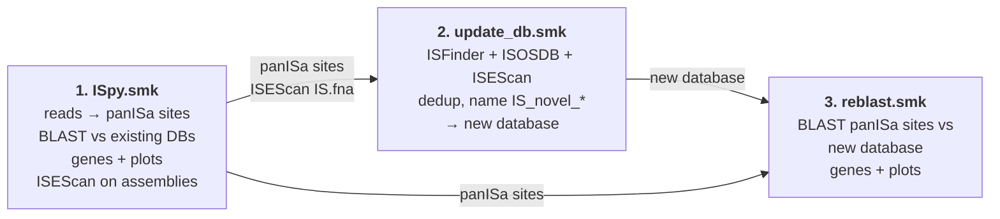

# ISpy

ISpy is a Snakemake pipeline for Illumina WGS data that does three things:
- finds insertion sequence (IS) elements;
- keeps a curated local IS database up to date;
- shows which genes each insertion hits.

Read preprocessing is the same as [ISScreener](https://github.com/kylegontjes/ISScreener) (Kyle Gontjes). ISScreener's ISfinder web search is replaced by a local BLAST against ISFinder, ISOSDB, a combined database, or a database you curate with ISpy.

ISpy is split into three Snakefiles, run in this order:



You can stop after step 1 if you only need calls against the existing databases.

---

## Inputs

| Input | Default location | Config key | Used by |
|---|---|---|---|
| Sample sheet | `config/samples.tsv` | `samples` | all |
| Paired reads | `fastq/<sample>_R1.fastq.gz`, `_R2.fastq.gz` | `input_reads`, `trim`, `trimmed_reads` | 1 |
| Sample assembly (FASTA) | `assembly/<sample>/<sample>.fna` | `assembly` | 1 (ISEScan), 2 (panISa rescue) |
| Reference genome (FASTA) | `reference/KPNIH1.fna` | `reference_genome` | 1, 3 |
| Reference annotation (GFF3) | `reference/KPNIH1.gff` | `reference_gff` | 1, 3 |
| ISFinder sequences | `IS_db/ISFinder/IS.fna` | `databases` | 1, 2 |
| ISOSDB sequences | `IS_db/ISOSDB/ISOSDB.V3.fna` | `databases` | 1, 2 |
| ISOSDB ID → IS family table | `IS_db/ISOSDB/IS_fam_annot.txt` | `isosdb_family_annotation` | 1, 3 (plots) |

Details:

- **Sample sheet.** Tab-separated, with a header line `sample_id` and then one sample name per line. The names must match the read and assembly file names.

  ```
  sample_id
  col_flux_Rmut_111
  ```

- **Reads.**
  - Raw reads (`trim: true`): `<input_reads>/<sample>_R1.fastq.gz` and `_R2.fastq.gz`. ISpy trims them with Trimmomatic.
  - Already-trimmed reads (`trim: false`): set `trimmed_reads`, e.g. `"fastq/{sample}_R{read}_trim_paired.fastq.gz"`. ISpy fills in `{sample}` and `{read}` (1 or 2).

- **Assembly.** Any assembly FASTA, such as SPAdes contigs or Prokka `.fna`.

- **Reference.**
  - The genome the reads are mapped to, plus its GFF3. Both Prokka and NCBI GFF3 files work.
  - The FASTA contig names must match the GFF's first column. NCBI-style names such as `gi|661922017|gb|CP008827.1|` are shortened to `CP008827.1` automatically.
  - The pipeline stops with an error if the FASTA and GFF share no contig name; otherwise no insertion could be linked to a gene. To fix it, rename the FASTA header, e.g. `sed -i 's/^>KPNIH1$/>CP008827.1/' reference/KPNIH1.fna`.
  - The bwa index is built automatically if it is missing.

- **IS databases.** These are included in this repo under `IS_db/`.
  - `IS.fna` comes from [thanhleviet/ISfinder-sequences](https://github.com/thanhleviet/ISfinder-sequences) (5,970 sequences). Its headers are `<name>_<family>_<group>`, e.g. `ISKpn26_IS5_IS5`, which is how plots get the IS family.
  - `IS_fam_annot.txt` is tab-separated with the columns `IS` (an ISOSDB ID) and `IS_fam`.

`reference/`, `fastq/` and `assembly/` are listed in `.gitignore`, so you have to provide them yourself.

---

## Installation

You need **Snakemake** and **conda/mamba**. Snakemake creates every tool environment from `envs/*.yaml` on first use.

```bash
mamba create -n ispy -c conda-forge -c bioconda snakemake
conda activate ispy
```

Always pass `--conda-prefix` with a path that has **no spaces**, e.g. `--conda-prefix ~/.ispy_conda`. Many conda tools break when their environment path contains a space, which is common in Dropbox or OneDrive folders. The project folder itself may contain spaces.

### Conda environments

| Env file | Tools | Tested versions |
|---|---|---|
| `envs/preprocess.yaml` | Trimmomatic, bwa, samtools, Picard (with OpenJDK) | Trimmomatic 0.41, bwa 0.7.19, samtools 1.25, Picard 3.5.0 |
| `envs/panisa.yaml` | panISa (pip), pysam, EMBOSS (`einverted`) | panISa 0.1.7, EMBOSS 6.6.0 |
| `envs/blast.yaml` | BLAST+, cd-hit, bedtools, Python | BLAST+ 2.17.0, cd-hit 4.8.1, bedtools 2.31.1, Python 3.10 |
| `envs/isescan.yaml` | ISEScan | ISEScan 1.7.3 |
| `envs/r_plot.yaml` | R with data.table, ggplot2, gggenes, ggrepel, ggvenn | R 4.5.3 |

Tested with Snakemake 9.27.1 on macOS (Apple silicon). All environments install natively there.

---

## Running

Run from the repo root:

```bash
snakemake -s ISpy.smk      --use-conda --conda-prefix ~/.ispy_conda --cores 8
snakemake -s update_db.smk --use-conda --conda-prefix ~/.ispy_conda --cores 8
snakemake -s reblast.smk   --use-conda --conda-prefix ~/.ispy_conda --cores 8
```

- Add `-n -p` for a dry run that lists the jobs without running them.
- Add `--conda-create-envs-only` to build the environments up front.
- Results go to `results/<prefix>/` and logs to `logs/<prefix>/` (`prefix` is set in the config, default `run1`).

**Changed a database FASTA in place?** Snakemake doesn't notice, so force the BLAST step to rerun, for example with `--forcerun local_db_blast` or `--forcerun update_db`.

**Cluster (Slurm, e.g. Great Lakes).** `ISpy.sbat` runs all three workflows in one job. Edit the email and account first. It uses `--cluster`, which only exists in Snakemake 7. With Snakemake 8 or later, use the [slurm executor plugin](https://snakemake.github.io/snakemake-plugin-catalog/plugins/executor/slurm.html) instead.

---

## Workflow 1: `ISpy.smk`

Finds insertion sites and identifies them against the existing databases listed in `blast_dbs`.

**Needs:**
- the sample sheet
- reads
- assemblies
- reference FASTA and GFF
- the databases in `blast_dbs`
- the family table

**Environments:** all five.

In the paths below, `R/` means `results/<prefix>/`, `<s>` is the sample and `<db>` is each database in `blast_dbs`.

| # | Step (rule) | Tool / script | Env | Input → output |
|---|---|---|---|---|
| 1 | `trim_raw_reads`, only with `trim: true` | Trimmomatic | preprocess | raw reads → `R/<s>/trimmomatic/<s>_R{1,2}_trim_{paired,unpaired}.fastq.gz` |
| 2 | `bwa_index`, skipped if the index exists | `bwa index` | preprocess | reference FASTA → `.amb .ann .bwt .pac .sa` next to the FASTA |
| 3 | `align_reads` | `scripts/bwa.sh` (bwa mem + samtools) | preprocess | trimmed reads → `<s>_sorted_aln.bam` (temporary) |
| 4 | `remove_pcr_duplicates` | Picard MarkDuplicates | preprocess | → `<s>_aln_marked.bam` (temporary), `R/<s>/align_reads/<s>_picard_metrics.txt` |
| 5 | `bam_sort` | samtools sort / index / flagstat | preprocess | → `R/<s>/align_reads/<s>_final.bam` + `.bai` |
| 6 | `panISa` | `panISa.py` | panisa | final BAM → `R/<s>/panISa/<s>_panISa.txt` (one row per insertion site) |
| 7 | `build_combined_db`, only with `combined: auto` | `scripts/update_IS_db.py` | blast | ISFinder + ISOSDB → `R/combined_db/IS_combined.fna` (exact duplicates removed) |
| 8 | `make_blastdb` | `scripts/makeblastdb.sh` | blast | database FASTA → `R/blastdb/<db>/<db>.*` |
| 9 | `local_db_blast` | `scripts/local_db_blast.py` | blast | panISa sites → `R/<s>/blast/<s>_<db>.tsv` |
| 10 | `ref_genes_bed` | `scripts/gff_to_bed.py` | blast | GFF → `R/reference/genes.bed` |
| 11 | `sites_bed` | `scripts/make_sites_bed.py` | blast | BLAST table → `R/<s>/annotation/<s>_<db>_sites.bed` |
| 12 | `nearby_genes` | `bedtools window` or `bedtools closest` | blast | sites + genes → `R/<s>/annotation/<s>_<db>_bedtools_<method>.tsv` |
| 13 | `summarize_sites` | `scripts/summarize_sites.py` | blast | → `R/<s>/annotation/<s>_<db>_IS_genes.tsv` |
| 14 | `master_tables` | awk | none | all samples → `R/<prefix>_<db>_master.tsv`, `R/<prefix>_<db>_IS_genes_master.tsv` |
| 15 | `faidx` | `samtools faidx` | preprocess | reference FASTA → `.fai` (contig lengths for plots) |
| 16 | `plot_IS_sites` | `scripts/plot_IS_sites.R` | r_plot | → `R/<s>/plots/<s>_<db>_{neighbourhood,overview,compressed}.pdf` |
| 17 | `compare_dbs`, only if both ISFinder and ISOSDB are searched | `scripts/compare_dbs.R` | r_plot | → `R/<s>/compare/<s>_ISFinder_vs_ISOSDB.tsv`, `R/<s>/plots/<s>_ISFinder_vs_ISOSDB_venn.pdf` |
| 18 | `isescan` | ISEScan | isescan | assembly → `R/isescan/<s>/<s>.is.fna` (full ISEScan output in `isescan_out/`) |

ISEScan (step 18) runs here, alongside the other steps, so that workflow 2 only has to read its output.

Each plot does this:
- **neighbourhood:** genes within `plot.flank` bp (default 3,000) of each insertion, one panel per site.
- **overview:** insertion sites along each contig.
- **compressed:** all site windows on one axis, with the gaps between them cut out.

In all of them, genes are coloured *disrupted by IS*, *flanking* or *hypothetical*, and insertions are labelled with their IS family.

## Workflow 2: `update_db.smk`

Builds a new, curated IS database. The originals are never modified.

**Needs:**
- the `update_db.base` databases (default ISFinder and ISOSDB)
- `R/isescan/<s>/<s>.is.fna` from workflow 1; if it is missing, ISEScan is run here
- if `panisa_rescue: true`: `R/<s>/panISa/<s>_panISa.txt` from workflow 1, and the assemblies

**Environments:** blast, plus isescan if ISEScan still has to run.

The work is done by the `update_db` rule (`scripts/update_IS_db.py`):

1. **Combine the base databases.** Earlier databases in the list win ties. Sequences identical on either strand are dropped, and repeated IDs get a `_v2` suffix.
2. **panISa rescue (optional).** For panISa sites whose IS ends match nothing in the combined database, find both ends in the sample assembly and cut out the sequence between them, so these elements can enter the database too.
3. **Cluster.** Cluster the ISEScan elements plus the rescued ones with cd-hit-est (`cluster_id` 0.95, `cluster_cov` 0.9).
4. **Known or novel.** BLAST each cluster representative against the combined database. It counts as known if a hit has ≥ `identity` % identity (default 95, the ISfinder threshold for "same IS") over ≥ `qcov` % of its length (default 90).
5. **Name novel elements** `IS_novel_NNNN_<family>`, using the family from ISEScan. Numbering continues from any `IS_novel_` IDs already in the base databases, so you can update incrementally from an earlier ISpy database.
6. **Write the database and its BLAST index.**

Outputs go to `<outdir>/<name>.*` (default `IS_db/ISpy_db_v1/ISpy_db_v1.*`):

| File | Contents |
|---|---|
| `<name>.fna` + BLAST index files | the new database |
| `<name>.novel.fna`, `<name>.novel_map.tsv` | novel elements only; map from new name to the original ISEScan header, length and cluster size |
| `<name>.ref_duplicates.tsv` | reference sequences dropped or renamed in step 1 |
| `<name>.isescan_clusters.tsv` | each ISEScan element and its cluster representative |
| `<name>.isescan_vs_db.tsv` | best database hit per representative, with the known/novel call |
| `<name>.panisa_rescue.tsv` | per panISa site: `extracted`, `already_matched`, `one_sided`, `ends_not_found`, `no_valid_pair` or `no_assembly` |
| `renamed_isescan/<s>.is.renamed.fna` | each sample's ISEScan elements under their database or `IS_novel_` names |

## Workflow 3: `reblast.smk`

Re-identifies every panISa site against the new database, then re-annotates and re-plots.

**Needs:**
- `R/<s>/panISa/<s>_panISa.txt` and the reference `.fai`, both from workflow 1
- `<outdir>/<name>.fna` from workflow 2
- the reference GFF
- the family table

**Environments:** blast, r_plot.

It runs steps 8–14 and 16 of workflow 1 with `<db>` set to `update_db.name`. One extra rule, `no_identity_report`, writes `R/<prefix>_<name>_no_identity.tsv`: every site still unmatched. That file is expected to be empty. Any site left in it is explained in `<name>.panisa_rescue.tsv`.

---

## Running the steps without Snakemake

Each script runs on its own inside the matching environment. Create the environment once:

```bash
conda env create -n ispy_blast -f envs/blast.yaml
conda activate ispy_blast
```

```bash
# Index a database (works in folders with spaces)
bash scripts/makeblastdb.sh IS_db/ISFinder/IS.fna blastdb/ISFinder/ISFinder

# Identify panISa sites. -r is stripped from the file name to give the sample name
python scripts/local_db_blast.py -d blastdb/ISFinder/ISFinder -r _panISa.txt \
    -o S1_ISFinder.tsv S1_panISa.txt

# Build an updated database
python scripts/update_IS_db.py --db IS_db/ISFinder/IS.fna IS_db/ISOSDB/ISOSDB.V3.fna \
    --isescan S1.is.fna S2.is.fna --panisa S1_panISa.txt S2_panISa.txt \
    --assembly-pattern "assembly/{sample}/{sample}.fna" --outdir IS_db/my_db --name my_db

# Genes near each site
python scripts/gff_to_bed.py reference/KPNIH1.gff --types CDS tRNA rRNA | LC_ALL=C sort -k1,1 -k2,2n > genes.bed
python scripts/make_sites_bed.py S1_ISFinder.tsv | LC_ALL=C sort -k1,1 -k2,2n > S1_sites.bed
bedtools window -a S1_sites.bed -b genes.bed -w 1000 > S1_window.tsv
python scripts/summarize_sites.py --sites S1_sites.bed --hits S1_window.tsv -o S1_IS_genes.tsv
```

Run any script with `--help` for its options.

The R plot scripts read their inputs from Snakemake's `snakemake@input` object, so run them through Snakemake.

---

## Output tables

**`blast/<s>_<db>.tsv`** has the same columns as panISa's `ISFinder_search.py`:

| Column | Meaning |
|---|---|
| `Sample`, `Chromosome`, `Start_Position`, `Stop_Position` | insertion site (the target-site duplication) |
| `Potential_sequence` | 30 bp of each IS end, as `left-right`, used as the BLAST query |
| `Potential_IS` | best-matching database entry, or `No identity` |
| `Alignment` | `two side`: both IS ends hit the same element; `one side`: only one end matched |

**`annotation/<s>_<db>_IS_genes.tsv`** has one row per site–gene pair:

| Column | Meaning |
|---|---|
| `sample`, `site`, `contig`, `start`, `end`, `Potential_IS`, `Alignment` | the insertion |
| `locus_tag`, `gene`, `product`, `feature_type` | the gene, from the GFF |
| `gene_start`, `gene_end`, `gene_strand` | gene coordinates |
| `distance` | bp between the insertion and the gene; 0 means the IS sits inside the gene |
| `position` | `inside_gene`, `upstream` or `downstream` (relative to the gene's strand), or `no_gene` when nothing is within range |

---

## Key options (`config/config.yaml`)

- `blast_dbs`: which databases workflow 1 searches. Any of the names under `databases`: `ISFinder`, `ISOSDB`, `combined`. `combined: auto` builds ISFinder + ISOSDB with exact duplicates removed.
- `local_blast`: BLAST filters. The defaults are panISa's: 30 bp per IS end, ≥ 90 % identity, e-value ≤ 0.001, and an alignment covering ≥ 80 % of the end.
- `annotation`: how genes are picked for each site.
  - `method: window` reports every gene within `distance` bp (default 1,000).
  - `method: closest` reports the `n_closest` nearest genes at any distance (default 3).
  - `feature_types` sets which GFF features count as genes (default CDS, tRNA, rRNA).
- `update_db`: the `base` databases to merge (in priority order), the new database's `name` and `outdir`, the known/novel cut-offs (`identity`, `qcov`), the cd-hit settings, and `panisa_rescue`. To update an earlier ISpy database, add it under `databases`, list it in `base`, and choose a new `name`.

---

## Credits

- Preprocessing and `bwa.sh` are adapted from [ISScreener](https://github.com/kylegontjes/ISScreener) © 2024 Kyle Gontjes (MIT License).
- `local_db_blast.py` reimplements `ISFinder_search.py` from [panISa](https://github.com/bvalot/panISa) (Treepong et al., GPL-3.0).
- ISFinder sequences: [thanhleviet/ISfinder-sequences](https://github.com/thanhleviet/ISfinder-sequences).
- Tools: [panISa](https://github.com/bvalot/panISa), [ISEScan](https://github.com/xiezhq/ISEScan), BLAST+, cd-hit, bedtools, bwa, samtools, Picard, Trimmomatic, gggenes.
